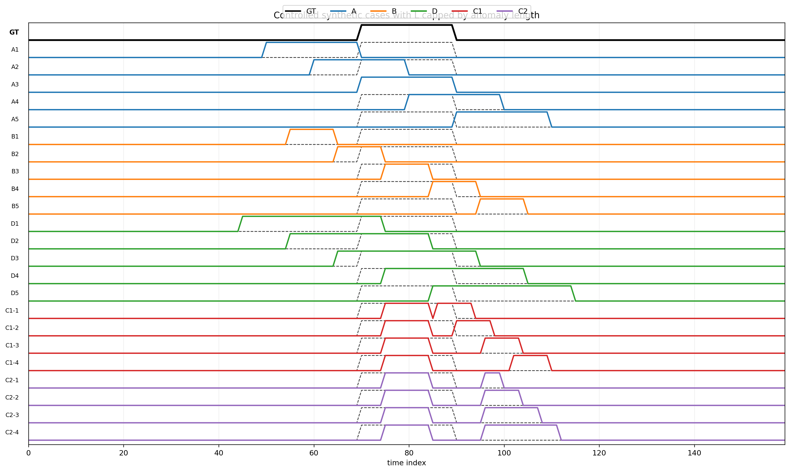
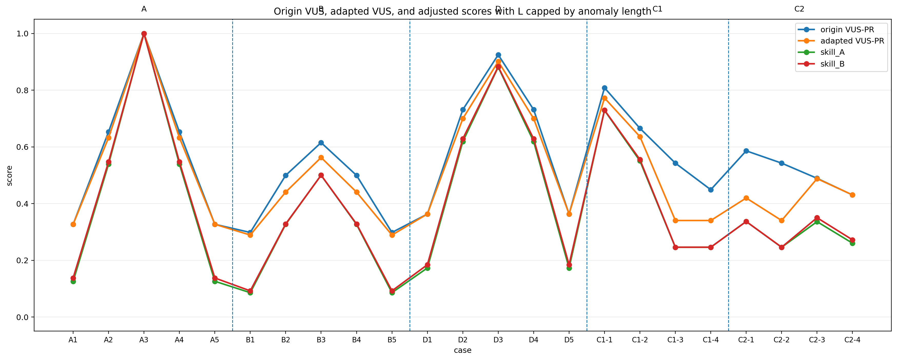

# Adjusted VUS — comparability brief (for the math review)

**Goal of this note.** We have a new anomaly-detection metric that selects a
*different buffer size for every anomaly–detector pair* and then collapses
everything into a single score. We need a proof that these single scores are
**comparable across detectors and across time series**, even though each was
computed with different per-anomaly buffers. This note gives only the two pieces
you need — (1) per-anomaly buffer selection, (2) the final single-score
computation — with pointers to the code. Everything else in the repo is
irrelevant to the proof.

---

## 1. Background: VUS in one paragraph

For a time series of length `T` we have a binary ground-truth label
`y ∈ {0,1}^T` (anomalies are contiguous segments) and a detector score
`s ∈ ℝ^T`. VUS introduces a **buffer** `b`: the label is "softened" by extending
a tolerance region of width `b` on each side of every anomaly, so a detection up
to `b` steps away still earns (partial) credit. For each buffer size
`b ∈ {0,1,…,L}` one computes a precision–recall area

```
A(b) = AUC-PR( detector s  vs  the b-buffered label )  ∈ [0,1].
```

Standard VUS (the accepted metric, with `L` fixed by the user, here `L=256`) is
the average over all buffers:

```
VUS = (1/(L+1)) · Σ_{b=0}^{L} A(b).
```

Our pipeline keeps `L=256` fixed for everyone. Two derived quantities matter:

- **Cumulative curve** `C(b) = (1/(b+1)) Σ_{j=0}^{b} A(j)` (so `VUS = C(L)`).
- **Marginal (de-cumulated) value** `A(b)`, recovered exactly from `C` by
  `A(b) = (b+1)·C(b) − b·C(b−1)`. *(code: `decumulate`)*

**Random baseline.** Under a random detector the expected AUC-PR at buffer `b`
equals the base rate of the `b`-buffered label:

```
g(b) = E[ A(b) | random detector ] = (positive area of the b-buffered label) / T.
```

This is exact for AUC-PR and is computed analytically (no Monte Carlo).
*(code: `_compute_denom_curve`, `denom='analytical'`)*. Note `g(b)` increases with
`b` (a wider buffer means more positives, so a higher chance baseline).

---

## 2. Step 1 — per-anomaly buffer selection

Let the label have anomalies `k = 1,…,K`. For each anomaly `k`:

1. Restrict to a window `W_k` around it (split the gap to each neighbour in half).
2. On that window compute the **marginal skill ratio**

   ```
   r_k(b) = A_k(b) / g_k(b),      b = 0,…,L
   ```

   where `A_k, g_k` are the marginal detector and baseline values of Step 1.
3. Select

   ```
   b*_k = argmax_{b}  r_k(b)
   ```

   (plus two “no-signal’’ guards: if the detector never beats chance, or the
   window contains no real signal, set `b*_k = 0`. These never drop a genuine
   detection.)

Intuition: `r_k(b)` is how many times better than chance the detector is when we
allow tolerance `b`; its argmax is the buffer that best captures this anomaly’s
detection. *(code: `compute_per_anomaly_adaptive_slicing` → `find_adaptive_buffer`
→ `select_best_buffer`; the marginal ratio is built at the line
`sel_ratio = marg_vus / marg_denom`.)*

**Selection and scoring are deliberately separate steps.** Step 1 only outputs the
vector `b* = (b*_1,…,b*_K)`. It does not produce the final score.

---

## 3. Step 2 — the final single score

Given `b*`, rebuild the label so that anomaly `k`’s buffer is **capped at `b*_k`**
(each anomaly may have a different cap), then run the usual VUS sweep `b=0,…,L`
once on this **adapted** label. Write `A*(b)` and `g*(b)` for the adapted
detector and baseline marginals, and

```
VUS_adapt = (1/(L+1)) Σ_b A*(b),     denom = (1/(L+1)) Σ_b g*(b).
```

From these we report (all in code: `score_adapt` / `_normalized_vus`):

| name        | formula                                            | range            |
|-------------|----------------------------------------------------|------------------|
| `ratio_A`   | `VUS_adapt / denom`                                 | `[0, ∞)`         |
| `ratio_B`   | `mean_b [ A*(b) / g*(b) ]`                          | `[0, ∞)`         |
| **`skill_A`** (headline, "Adjusted VUS") | `(VUS_adapt − denom) / (1 − denom)` | `(−·, 1]`, 0=chance |
| `skill_B`   | `mean_b [ (A*(b) − g*(b)) / (1 − g*(b)) ]`          | `(−·, 1]`, 0=chance |

The headline metric is **`skill_A`**, the *chance-adjusted* score. It is exactly
the “adjustment for chance’’ used by the **Adjusted Rand Index** and **Adjusted
Mutual Information**:

```
adjusted = (index − E[index | random]) / (max index − E[index | random]),
```

with `index = VUS_adapt`, `E[index|random] = denom`, `max = 1`. So `skill_A = 0`
for a random detector and `skill_A = 1` for a perfect one.

---

## 4. What we would like you to prove

The supervisor’s objection: *“each anomaly–detector pair picks a different `b*`,
so the single scores are computed under different conditions — why are they
comparable?”* Concretely, we’d like (any subset of) the following made rigorous.

**Proposition A (calibration, fixed buffers).** For any label `y` and any fixed
per-anomaly cap vector `b*` (not chosen from the data), if the detector is random
then `E[skill_A] = 0`; and `skill_A ≤ 1` always, with `= 1` iff the detector is
perfect. Same for `skill_B`. *(Note `denom` is deterministic given the
configuration, which should make this clean.)*

**Proof (A).**
Write the fixed per-anomaly cap vector as $c=(c_1,\ldots,c_K)$; in the notation of the metric, this is the fixed vector `b*`. For each VUS sweep level $\ell\in\{0,\ldots,L\}$, let

```math
\tilde y_{\ell,c}(t)\in[0,1]
```

denote the adapted soft label. Original anomalous points have value $1$, buffer points have values in $(0,1)$, and background points have value $0$.

For a threshold $\tau$, define

```math
R_\tau=\{t:s(t)\ge \tau\}.
```

The threshold-level weighted true-positive and false-positive masses are

```math
TP_{\ell,c}(\tau)=\sum_{t\in R_\tau}\tilde y_{\ell,c}(t),
```

```math
FP_{\ell,c}(\tau)=\sum_{t\in R_\tau}\bigl(1-\tilde y_{\ell,c}(t)\bigr).
```

Since $0\le \tilde y_{\ell,c}(t)\le 1$,

```math
FP_{\ell,c}(\tau)\ge 0.
```

Hence

```math
\mathrm{Prec}_{\ell,c}(\tau)
=
\frac{TP_{\ell,c}(\tau)}{TP_{\ell,c}(\tau)+FP_{\ell,c}(\tau)}
\le 1,
```

and similarly $\mathrm{Rec}_{\ell,c}(\tau)\le 1$. Therefore every threshold-level point on the PR curve lies in the unit square, and

```math
A_{\ell,c}(s)\le 1,
```

where $A_{\ell,c}(s)$ is the AUC-PR at sweep level $\ell$. Thus

```math
V_c(s)=\frac{1}{L+1}\sum_{\ell=0}^{L}A_{\ell,c}(s)\le 1.
```

Let

```math
g_{\ell,c}=\frac{1}{T}\sum_{t=1}^{T}\tilde y_{\ell,c}(t),
\qquad
D_c=\frac{1}{L+1}\sum_{\ell=0}^{L}g_{\ell,c}.
```

Then

```math
\mathrm{skill}_A(c,s)=\frac{V_c(s)-D_c}{1-D_c}\le 1.
```

Also, since $A_{\ell,c}(s)\le 1$ for every $\ell$,

```math
\frac{A_{\ell,c}(s)-g_{\ell,c}}{1-g_{\ell,c}}\le 1,
```

and hence

```math
\mathrm{skill}_B(c,s)
=
\frac{1}{L+1}\sum_{\ell=0}^{L}
\frac{A_{\ell,c}(s)-g_{\ell,c}}{1-g_{\ell,c}}
\le 1.
```

We next show that the upper endpoint is achieved only by a perfect detector. A perfect detector means that its score is order-equivalent to the original binary label: all original anomalous points are ranked above all non-anomalous points; equivalently, after thresholding, the detector can exactly recover the original anomaly label.

For such a detector, in the Step-1 local window of anomaly $k$, the zero-buffer label is already perfectly matched, so

```math
A_k(0)=1.
```

For any $b>0$ that adds nonempty buffer area, the baseline strictly increases,

```math
g_k(b)>g_k(0),
```

while $A_k(b)\le 1$. Therefore the Step-1 marginal skill ratio satisfies

```math
r_k(b)=\frac{A_k(b)}{g_k(b)}
\le
\frac{1}{g_k(b)}
<
\frac{1}{g_k(0)}
=
\frac{A_k(0)}{g_k(0)}
=
r_k(0).
```

Thus the maximizer is $b_k^*=0$ for every anomaly $k$; if a positive buffer width adds no new time points, it is equivalent to zero and the smallest maximizer is selected. Hence a perfect detector yields

```math
b^*=(0,\ldots,0).
```

The final adapted label is then the original binary label, with no fractional buffer region. Therefore

```math
A_{\ell,b^*}(s)=1\quad\forall \ell,
```

so

```math
V_{b^*}(s)=1,
\qquad
\mathrm{skill}_A(b^*,s)=1,
\qquad
\mathrm{skill}_B(b^*,s)=1.
```

Conversely, suppose some selected cap is nonzero and produces a nonempty buffer region. Then for some sweep level $\ell$ there exists a buffer point $t$ with

```math
0<\tilde y_{\ell,b^*}(t)<1.
```

If this point is selected at any threshold, it contributes positive false-positive mass

```math
1-\tilde y_{\ell,b^*}(t)>0.
```

Therefore precision cannot remain equal to $1$ over all recall-increasing thresholds, and hence

```math
A_{\ell,b^*}(s)<1
```

for at least one sweep level $\ell$. Consequently,

```math
V_{b^*}(s)<1,
\qquad
\mathrm{skill}_A(b^*,s)<1,
\qquad
\mathrm{skill}_B(b^*,s)<1.
```

If no nonzero buffer is selected, then reaching $A_{0,b^*}(s)=1$ still requires all original anomalous points to be ranked above all background points. Thus equality at the upper endpoint occurs if and only if the detector is perfect.

It remains to verify the chance endpoint. Fix $c$ and suppose $s$ is random and independent of the label. Conditional on $|R_\tau|=m$, $R_\tau$ is a uniformly random subset of size $m$. Hence

```math
\mathbb{E}\left[
\mathrm{Prec}_{\ell,c}(\tau)
\mid |R_\tau|=m
\right]
=
\mathbb{E}\left[
\frac{1}{m}\sum_{t\in R_\tau}\tilde y_{\ell,c}(t)
\right]
=
\frac{1}{T}\sum_{t=1}^{T}\tilde y_{\ell,c}(t)
=
g_{\ell,c}.
```

Thus the analytical random baseline at sweep level $\ell$ is

```math
\mathbb{E}\left[A_{\ell,c}(s)\mid s\ \mathrm{random}\right]
=
g_{\ell,c}.
```

Averaging over sweep levels gives

```math
\mathbb{E}\left[V_c(s)\mid s\ \mathrm{random}\right]
=
\frac{1}{L+1}\sum_{\ell=0}^{L}
\mathbb{E}\left[A_{\ell,c}(s)\mid s\ \mathrm{random}\right]
=
\frac{1}{L+1}\sum_{\ell=0}^{L}g_{\ell,c}
=
D_c.
```

Since $c$ is fixed, $D_c$ is deterministic with respect to the detector randomness. Therefore

```math
\mathbb{E}\left[\mathrm{skill}_A(c,s)\mid s\ \mathrm{random}\right]
=
\frac{
\mathbb{E}\left[V_c(s)\mid s\ \mathrm{random}\right]-D_c
}{1-D_c}
=
0.
```

For `skill_B`, linearity of expectation gives

```math
\mathbb{E}\left[\mathrm{skill}_B(c,s)\mid s\ \mathrm{random}\right]
=
\frac{1}{L+1}\sum_{\ell=0}^{L}
\frac{
\mathbb{E}\left[A_{\ell,c}(s)\mid s\ \mathrm{random}\right]-g_{\ell,c}
}{1-g_{\ell,c}}
=
0.
```

Therefore, for any fixed cap configuration, both `skill_A` and `skill_B` map a random detector to $0$ in expectation and map a perfect detector uniquely to $1$.

**Proposition B (cross-pair comparability — the main one).** For two detectors on
the same label, each with its own selected `b*`, the resulting `skill_A` values
lie on a common scale (`0` = chance, `1` = perfect) **independent of which `b*`
each chose**. Make precise the sense in which “0 and 1 mean the same thing across
different buffer configurations,” and show ranking by `skill_A` is therefore
well-defined across detectors — and across different time series.

**Proof (B).**
Let two detectors $s_a$ and $s_b$ be evaluated under possibly different per-anomaly cap vectors $b_a^*$ and $b_b^*$. Their raw adapted VUS values are

```math
V_{b_a^*}(s_a),
\qquad
V_{b_b^*}(s_b).
```

These raw values are not directly comparable in general, because the two cap vectors may induce different adapted labels and therefore different chance baselines,

```math
D_{b_a^*}\ne D_{b_b^*}.
```

The adjusted scores are

```math
\mathrm{skill}_A(b_a^*,s_a)
=
\frac{V_{b_a^*}(s_a)-D_{b_a^*}}{1-D_{b_a^*}},
```

```math
\mathrm{skill}_A(b_b^*,s_b)
=
\frac{V_{b_b^*}(s_b)-D_{b_b^*}}{1-D_{b_b^*}}.
```

By Proposition A, for every fixed cap vector $b^*$,

```math
\mathbb{E}\left[\mathrm{skill}_A(b^*,s)\mid s\ \mathrm{random}\right]=0,
\qquad
\mathrm{skill}_A(b^*,s)=1
\iff
s\ \mathrm{is\ perfect}.
```

Thus each configuration-specific raw VUS is mapped to the same normalized endpoints,

```math
0=\mathrm{chance},
\qquad
1=\mathrm{perfect}.
```

Equivalently,

```math
\mathrm{skill}_A(b^*,s)
=
\frac{
\mathrm{actual\ performance}-\mathrm{chance\ performance}
}{
\mathrm{perfect\ performance}-\mathrm{chance\ performance}
}.
```

Therefore `skill_A` is a dimensionless fraction of the attainable improvement from chance to perfect. This interpretation is invariant to the particular cap vector $b^*$, so scores computed under different per-anomaly buffer configurations lie on a common calibrated scale.

The same argument applies to `skill_B`. For two cap vectors $b_a^*$ and $b_b^*$,

```math
\mathrm{skill}_B(b_a^*,s_a)
=
\frac{1}{L+1}\sum_{\ell=0}^{L}
\frac{A_{\ell,b_a^*}(s_a)-g_{\ell,b_a^*}}{1-g_{\ell,b_a^*}},
```

and

```math
\mathrm{skill}_B(b_b^*,s_b)
=
\frac{1}{L+1}\sum_{\ell=0}^{L}
\frac{A_{\ell,b_b^*}(s_b)-g_{\ell,b_b^*}}{1-g_{\ell,b_b^*}}.
```

By Proposition A,

```math
\mathbb{E}\left[\mathrm{skill}_B(b^*,s)\mid s\ \mathrm{random}\right]=0,
\qquad
\mathrm{skill}_B(b^*,s)=1
\iff
s\ \mathrm{is\ perfect},
```

for every fixed cap vector $b^*$. Hence `skill_B` is also on the same chance-to-perfect scale.

Therefore, replacing a fixed global buffer by a per-anomaly vector `b*` preserves comparability after chance adjustment: different detector--time-series pairs may have different adapted labels and different denominators, but after applying the corresponding adjustment, the endpoints have the same meaning across all pairs. Ranking by `skill_A` or `skill_B` is therefore well-defined in the fixed-configuration sense.

This does not yet account for the additional optimistic bias introduced when `b*` is selected by an `argmax` over noisy detector-dependent curves. That issue is separate from fixed-configuration calibration and is addressed in Proposition C.

**Proposition C (selection bias / winner’s curse).** Propositions A–B assume the
buffers are fixed. But `b*` is chosen by `argmax` over a noisy curve (Step 1), so
even a random detector, *after selection*, scores slightly above chance. We
observe empirically `E[skill_A | random] ≈ 0` for fixed buffers but `> 0` after
selection. We’d like: a bound/characterization of this optimistic bias as a
function of `L` and the number of anomalies `K`, and an argument that because the
bias is **shared** (every detector gets the same argmax freedom over the same
buffer grid) the **ranking** between detectors is still preserved.

**Discussion (C).**
Propositions A and B establish calibration conditional on a fixed per-anomaly buffer configuration. In the full adaptive pipeline, however, the cap vector is not fixed. It is selected from the detector scores:

```math
b^*(s)=B(y,s).
```

This introduces a standard selection effect. Even for a random detector, the marginal skill curve fluctuates around its chance level at each candidate buffer.
Selecting

```math
b_k^*=\arg\max_b r_k(b)
```

therefore selects the largest upward fluctuation. Hence the post-selection random baseline is generally not exactly zero:

```math
\mathbb{E}[\mathrm{skill}_A(b^*(s),s)\mid s\ \mathrm{random}] \ge 0,
```

and in finite samples it can be strictly positive.

This effect should be interpreted as a winner's-curse or optimistic-selection bias. Its magnitude depends on the number of candidate buffers \(L+1\), the number of anomalies \(K\), and the amount of finite-sample noise in the local marginal VUS curves. Importantly, the same selection rule and the same buffer grid are applied to every detector. Thus the adaptive step does not introduce detector-specific tuning freedom; it only introduces a shared post-selection effect induced by the common search procedure.

For this reason, we do not rely on Proposition C as a claim of unconditional ranking preservation. Instead, Propositions A and B provide the calibration result conditional on a selected configuration, while the remaining question is whether the post-selection scores behave monotonically in controlled detector scenarios. We therefore validate the ranking behavior empirically by comparing detectors with systematically varied localization quality and showing that the adjusted VUS scores increase or decrease in the expected direction.

### Empirical validation under anomaly-length-capped adaptive buffers

In the controlled experiments, we additionally constrain the adaptive buffer search range by the duration of each anomaly. Let \(L_{\mathrm{global}}\) denote the global maximum buffer size. For anomaly \(k\), we restrict the candidate buffer set to

```math
b_k^* \in \{0,\ldots,L_k\},
\qquad
L_k=\min(L_{\mathrm{global}}, |A_k|).
```

In our synthetic example, the ground-truth anomaly has length \(|A_k|=20\), and we set \(L_{\mathrm{global}}=20\). Therefore the adaptive selection is only allowed to choose

```math
b_k^* \in \{0,\ldots,20\}.
```

This setting prevents the selected tolerance window from exceeding the temporal scale of the anomaly itself. In particular, it avoids allowing a short anomaly to explain very distant false-positive regions through an excessively large buffer.

| |
|:--:|
|  |

Under this anomaly-length-capped setting, the first three groups of controlled cases behave as expected. When the predicted segment has the same duration as the ground-truth anomaly, the adjusted scores are maximized when the prediction is aligned with the true event and decrease as the prediction shifts away. When the predicted segment is shorter, the scores are lower because only part of the anomaly is covered. When the predicted segment is longer, the score remains relatively high near the aligned case but decreases when the prediction includes excessive regions outside the anomaly. These results support the empirical monotonicity of the adjusted scores under controlled changes in localization and coverage.

| |
|:--:|
|  |

The final group illustrates an edge case caused by the adaptive selection step. In this setting, the detector always captures the middle portion of the anomaly, while an additional predicted segment is placed after the anomaly and gradually increases in length. For shorter external segments, the selected buffer remains small or zero, so the external segment is treated primarily as a false-positive region and the adjusted score decreases. However, once the external segment becomes sufficiently long, the marginal contribution within the candidate buffer can exceed the corresponding random baseline. The adaptive procedure then selects a nonzero buffer, so part of the external segment receives partial credit as a delayed detection rather than being treated entirely as a false positive.

This behavior is consistent with the design of adaptive VUS. The increase in the adjusted score is not introduced by the final skill normalization itself, but by the selected cap vector \(b^*(s)\). Once \(b_k^*>0\), the adapted label expands the tolerated region around the anomaly, and predictions within this region can improve the adapted VUS. Thus, the edge case shows that adaptive VUS can reward temporally consistent delayed responses when their marginal gain is stronger than chance, while the anomaly-length cap prevents this tolerance from expanding beyond the temporal scale of the event.

---

## 5. Minimal code map

All in `src/vus/vus_numpy.py` (class `VUSNumpy`):

| concept                                   | location                                  |
|-------------------------------------------|-------------------------------------------|
| per-buffer VUS sweep `C(b)` (`cumulative=True`) | `compute(...)`, aggregation in `auc` (line ~1786) |
| de-cumulate `C(b) → A(b)`                 | `decumulate` (line ~1821)                 |
| random baseline `g(b)` (analytical)       | `_compute_denom_curve` (line ~538)        |
| **Step 1**: per-anomaly `b*` selection    | `compute_per_anomaly_adaptive_slicing` (line ~735) → `find_adaptive_buffer` (line ~583) → `select_best_buffer` (line ~215) |
| marginal skill ratio `r_k(b)`             | `find_adaptive_buffer`, `sel_ratio = marg_vus / marg_denom` (line ~641) |
| build adapted (capped) label              | `_build_capped_labels` (line ~1855)       |
| **Step 2**: final single score            | `score_adapt` (line ~1928) → `_normalized_vus` (line ~1885) |

Scope reminder: only Sections 2 and 3 (Steps 1 and 2) are in scope. The rest of
the file is the underlying VUS machinery, which you can treat as a black box that
returns `A(b)` and `g(b)`.
