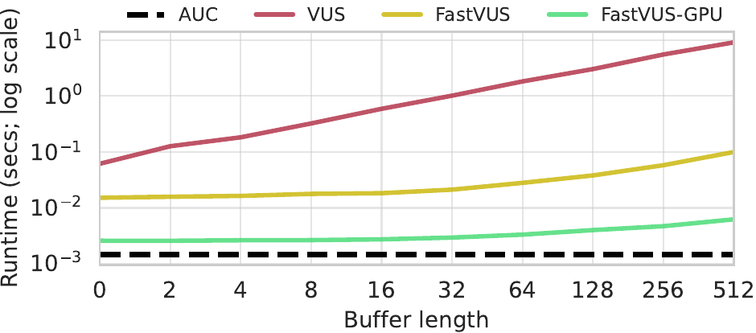

# Supplementary results

Results left out of the paper for space reasons, with the text that accompanied them.

## Runtime as a function of the maximum buffer length

The buffer is one of the central concepts of VUS, so we analyze how the runtime of our measures behaves as the buffer length grows, measured on a single detector. The figure below reports our results. VUS (in red) is the slowest of the three, with one order of magnitude difference at buffer length 0 that grows to three orders of magnitude at buffer length 512, compared to FastVUS-GPU (in green). VUS is also the most affected by the increase in buffer length, starting at about 60 milliseconds per time series for buffer length 0 (no buffer) and increasing to about 10 seconds per time series for the maximum evaluated buffer. Then follows FastVUS, whose runtime remains almost constant up to buffer length 16. Finally, FastVUS-GPU behaves like FastVUS but is an order of magnitude faster, of the same order as AUC. Overall, both our approaches scale well with buffer length and remain practical for lengths up to 512.

Average runtime per time series for VUS (red), FastVUS (yellow), and FastVUS-GPU (green) with respect to the buffer length (x-axis in log scale). The black dashed line is the average runtime of AUC. Buffer lengths 0, 2, 4, ..., 512. PDF: [runtime_vs_buffer_length.pdf](runtime_vs_buffer_length.pdf).

## Optional step parameter of FastVUS

FastVUS adds an optional *step* parameter that evaluates every k-th buffer rather than all of them, trading a small, controlled error for speed. More usefully, because FastVUS evaluates the measure per buffer, restricting it to a single buffer length (step equal to L) approximates other event-aware measures such as Range-AUC (Paparrizos et al., VLDB 2022) or SoftED (Salles et al., 2024), so the step parameter also lets the same machinery estimate a family of buffer-based metrics, not only VUS. This is the only approximation in FastVUS and it is off by default (`step=1`).

## Benchmark-wide comparison: additional results

Additional results of the benchmark-wide comparison of the paper (TSB-AD, 870 series, 32 detectors, 27,788 series-detector pairs). They come from the same run as the rank figure of the paper. The global ranking of a measure ranks the detectors by their mean score over the series. Scripts: `src/experiments/autovus_benchmark.py` (run) and `src/experiments/analyze_autovus_benchmark.py` (numbers below).

### Ranking of all 32 detectors

The paper shows the nine best detectors under AutoVUS. The table below gives the rank of every detector under AUC-PR, VUS with maximum buffer length L from 2 to 128, and AutoVUS at L = 128 and L = 20, ordered by AutoVUS at L = 128.

| Detector | AUC-PR | VUS@2 | VUS@4 | VUS@8 | VUS@16 | VUS@32 | VUS@64 | VUS@128 | AutoVUS@128 | AutoVUS@20 |
|---|---:|---:|---:|---:|---:|---:|---:|---:|---:|---:|
| TimesFM | 1 | 1 | 1 | 1 | 1 | 1 | 2 | 5 | 1 | 1 |
| Chronos | 3 | 2 | 2 | 2 | 2 | 3 | 5 | 11 | 2 | 2 |
| SR | 2 | 3 | 3 | 3 | 4 | 5 | 10 | 14 | 3 | 3 |
| Lag_Llama | 5 | 4 | 4 | 5 | 5 | 4 | 9 | 13 | 4 | 4 |
| MOMENT_FT | 13 | 13 | 14 | 14 | 12 | 9 | 3 | 1 | 5 | 9 |
| MOMENT_ZS | 15 | 15 | 15 | 15 | 13 | 12 | 4 | 2 | 6 | 10 |
| CNN | 4 | 5 | 6 | 6 | 8 | 11 | 14 | 15 | 7 | 5 |
| MatrixProfile | 14 | 12 | 12 | 11 | 10 | 10 | 8 | 7 | 8 | 8 |
| Series2Graph | 10 | 10 | 9 | 9 | 9 | 8 | 7 | 6 | 9 | 7 |
| Sub_LOF | 18 | 18 | 18 | 17 | 17 | 15 | 13 | 4 | 10 | 17 |
| LOF | 16 | 14 | 13 | 12 | 11 | 13 | 12 | 10 | 11 | 14 |
| Sub_KNN | 17 | 17 | 17 | 16 | 15 | 14 | 15 | 9 | 12 | 16 |
| KShapeAD | 6 | 6 | 5 | 4 | 3 | 2 | 1 | 3 | 13 | 6 |
| KMeansAD_U | 8 | 9 | 8 | 8 | 7 | 6 | 6 | 8 | 14 | 11 |
| LSTMAD | 7 | 7 | 10 | 10 | 14 | 16 | 18 | 22 | 15 | 12 |
| TimesNet | 22 | 21 | 22 | 23 | 20 | 18 | 16 | 16 | 16 | 19 |
| SAND | 9 | 8 | 7 | 7 | 6 | 7 | 11 | 12 | 17 | 13 |
| FITS | 29 | 29 | 29 | 30 | 29 | 28 | 23 | 19 | 18 | 27 |
| Sub_PCA | 11 | 11 | 11 | 13 | 16 | 17 | 17 | 20 | 19 | 15 |
| OFA | 27 | 28 | 27 | 26 | 26 | 23 | 19 | 17 | 20 | 26 |
| Sub_MCD | 26 | 24 | 24 | 24 | 23 | 20 | 20 | 18 | 21 | 24 |
| AutoEncoder | 21 | 22 | 25 | 25 | 25 | 25 | 21 | 21 | 22 | 25 |
| POLY | 28 | 27 | 23 | 22 | 22 | 22 | 24 | 23 | 23 | 21 |
| OmniAnomaly | 12 | 16 | 16 | 18 | 18 | 19 | 22 | 25 | 24 | 18 |
| USAD | 19 | 19 | 19 | 19 | 19 | 21 | 25 | 26 | 25 | 20 |
| Sub_OCSVM | 30 | 30 | 30 | 29 | 27 | 26 | 26 | 24 | 26 | 29 |
| TranAD | 23 | 25 | 21 | 21 | 21 | 24 | 27 | 27 | 27 | 22 |
| IForest | 20 | 20 | 20 | 20 | 24 | 27 | 28 | 30 | 28 | 23 |
| Sub_HBOS | 25 | 23 | 26 | 27 | 28 | 29 | 29 | 29 | 29 | 28 |
| Donut | 31 | 31 | 31 | 31 | 31 | 31 | 30 | 28 | 30 | 31 |
| Sub_IForest | 24 | 26 | 28 | 28 | 30 | 30 | 31 | 31 | 31 | 30 |
| AnomalyTransformer | 32 | 32 | 32 | 32 | 32 | 32 | 32 | 32 | 32 | 32 |

### Rank agreement between measures

Kendall tau between the global rankings (32 detectors).

| Measure | tau with AutoVUS@128 | tau with VUS@128 |
|---|---:|---:|
| AUC-PR | 0.60 | 0.41 |
| VUS@2 | 0.62 | 0.43 |
| VUS@4 | 0.62 | 0.44 |
| VUS@8 | 0.63 | 0.46 |
| VUS@16 | 0.68 | 0.54 |
| VUS@20 | 0.69 | 0.57 |
| VUS@32 | 0.75 | 0.63 |
| VUS@64 | 0.79 | 0.82 |
| VUS@128 | 0.72 | |
| AutoVUS@20 | 0.75 | 0.56 |

The agreement of AutoVUS@128 with VUS is at least 0.62 for every L, whereas VUS@128 and VUS@2 agree at 0.43. AutoVUS@128 agrees less with AUC-PR (0.60) than with VUS at any L.

### Sensitivity to the maximum buffer length

We compare each measure at L = 128 with the same measure at L = 20.

| | AutoVUS@128 and AutoVUS@20 | VUS@128 and VUS@20 |
|---|---:|---:|
| Kendall tau, global ranking | 0.75 | 0.57 |
| Kendall tau per series, median | 0.854 | 0.853 |
| Series with the same best detector | 85.6% | 86.3% |

### Random detector

Scores drawn uniformly at random, three seeds per series. Mean, standard deviation and 95th percentile over the series and seeds.

| Measure | Mean | Std | 95th percentile |
|---|---:|---:|---:|
| AUC-PR | 0.026 | 0.041 | 0.128 |
| VUS@2 | 0.031 | 0.051 | 0.128 |
| VUS@4 | 0.036 | 0.063 | 0.134 |
| VUS@8 | 0.045 | 0.083 | 0.155 |
| VUS@16 | 0.062 | 0.110 | 0.201 |
| VUS@20 | 0.068 | 0.119 | 0.238 |
| VUS@32 | 0.085 | 0.141 | 0.317 |
| VUS@64 | 0.116 | 0.176 | 0.463 |
| VUS@128 | 0.162 | 0.219 | 0.646 |
| AutoVUS@20 | 0.013 | 0.031 | 0.074 |
| AutoVUS@128 | 0.038 | 0.086 | 0.174 |

The score of a random detector under VUS grows with L, from 0.026 without buffer to 0.162 at L = 128. Under AutoVUS at L = 128 it is 0.038. For reference, the mean over the real detectors is 0.392 for VUS@128 and 0.262 for AutoVUS@128.

### Selected buffers

Over the 1,101,759 anomaly-detector pairs at L = 128, AutoVUS selects no buffer (b* = 0) for 47.9% of them, a buffer strictly between 0 and 128 for 51.4%, and the maximum buffer for 0.7%. The median selected buffer is 1 and the 90th percentile is 22.
